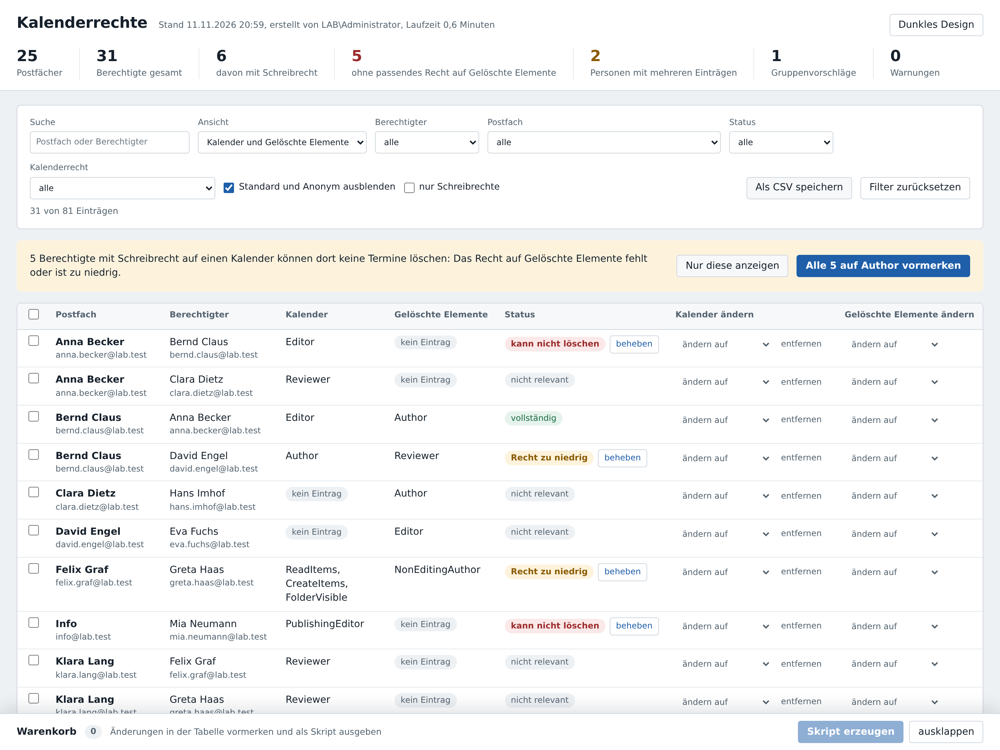
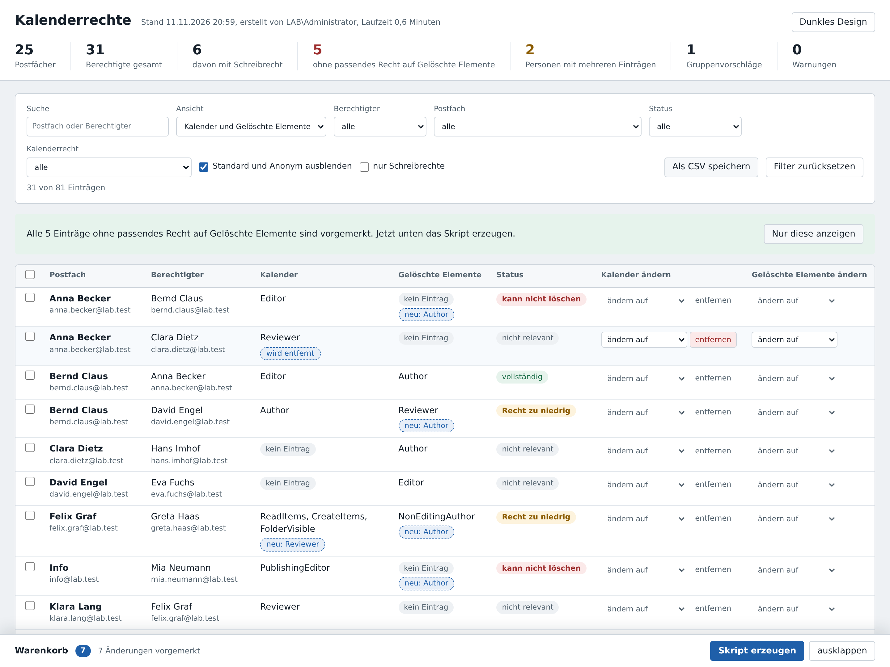
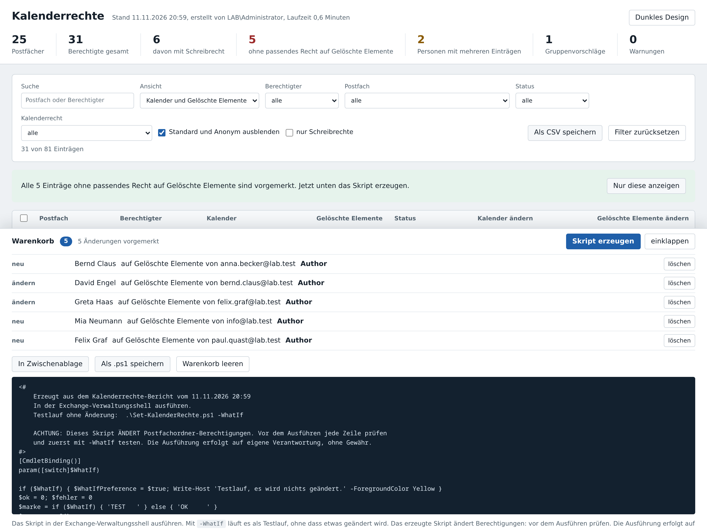
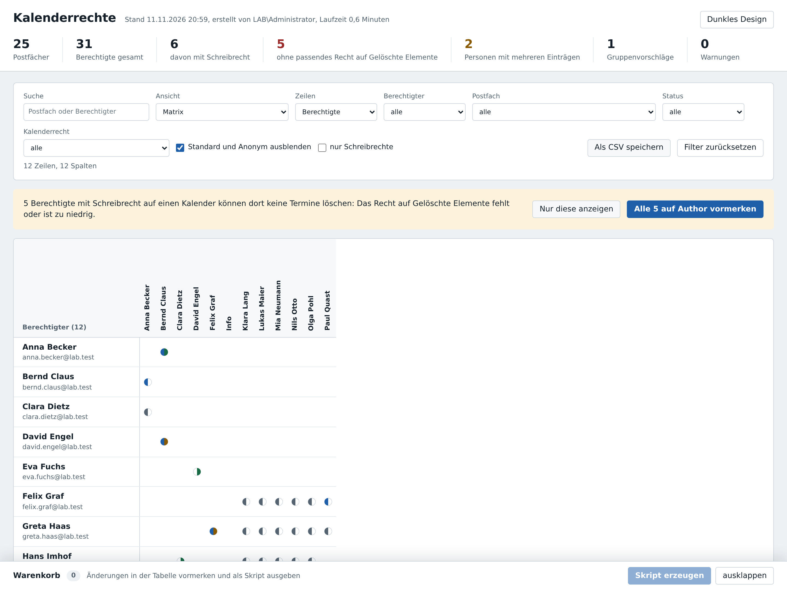
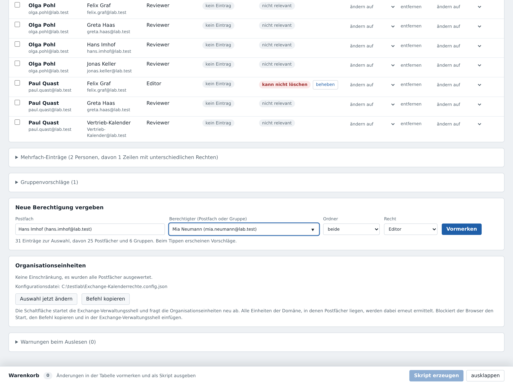
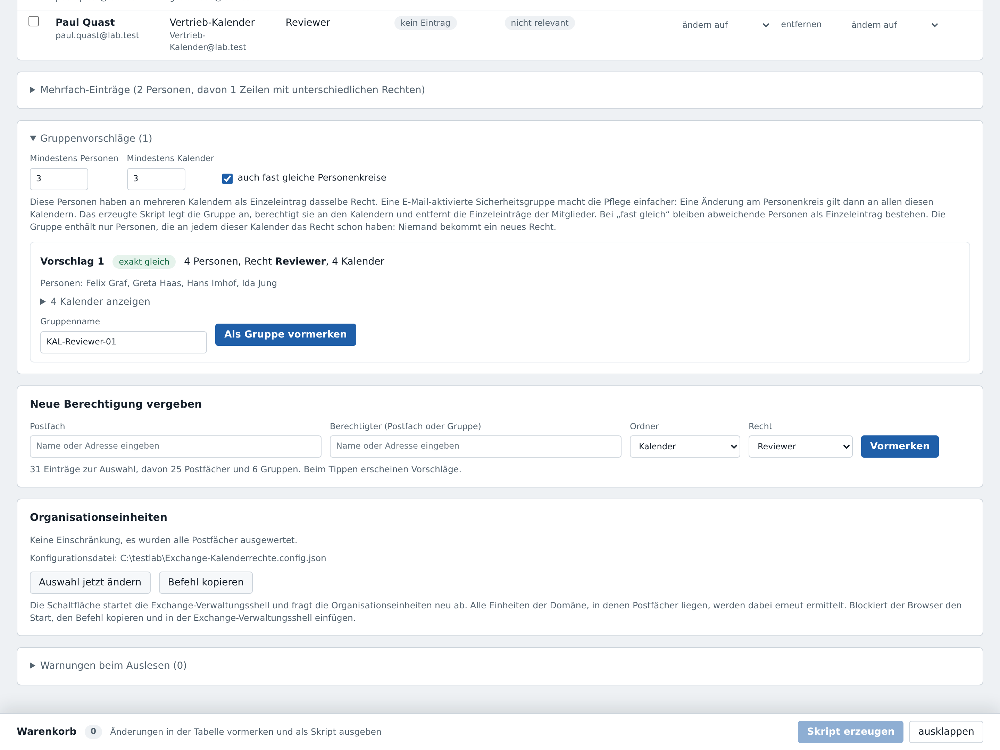
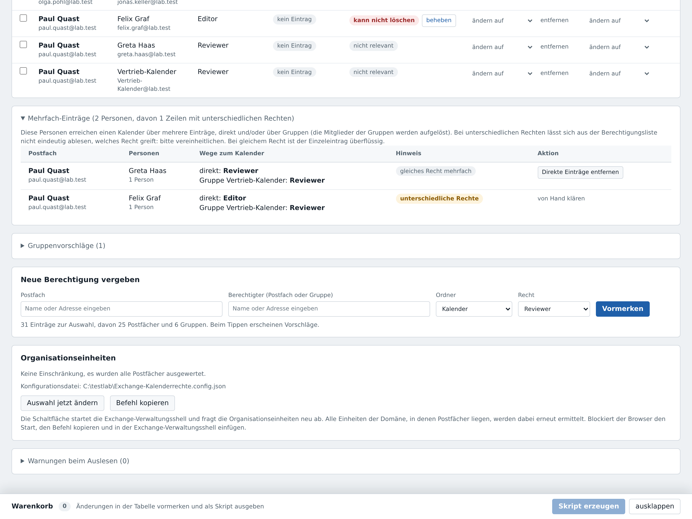
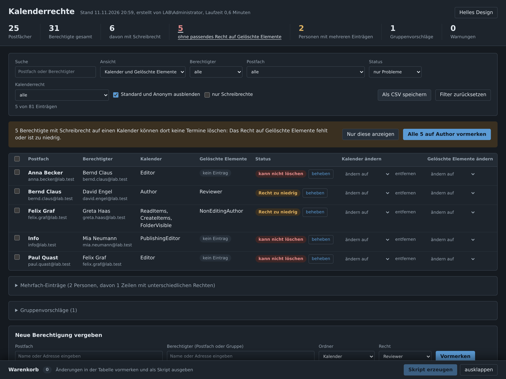

# Exchange-Kalenderrechte – Kalender-Berechtigungen in Exchange Server auswerten

PowerShell-Skript für **Exchange Server (lokal installiert)**: liest für alle Postfächer die Berechtigungen des Kalenders und des Ordners „Gelöschte Elemente“ aus und zeigt in einem interaktiven **HTML-Bericht auf Deutsch oder Englisch** (`-Language de|en`, Standard je nach Windows-Sprache), wer auf welchen Kalender zugreifen darf – und wo ein Stellvertreter Termine nicht löschen kann.

**Dieses Verzeichnis enthält kein Skript, nur Bilder der Funktionen.** Das Skript lässt sich nicht sinnvoll in eine gekürzte kostenlose Fassung teilen. Die Vollversion gibt es hier:

➜ **[Vollversion auf Gumroad](https://mueller86.gumroad.com/l/iabfb)** · **[Vollversion auf Etsy](https://www.etsy.com/listing/4614799790)** · **[alle Skripte im Shop](https://www.etsy.com/shop/ITAdminToolsbyMM)**

Alle Bilder stammen aus einer Testumgebung mit erfundenen Postfächern.

## Übersicht

Kennzahlen im Kopf, Filter, und eine Zeile je Postfach und Berechtigtem mit Bewertung: vollständig, Recht zu niedrig, kann nicht löschen.

## Probleme mit einem Klick vormerken

Fehlt das Recht auf „Gelöschte Elemente“ oder ist es zu niedrig, merkt ein Klick die Korrektur vor – je Zeile oder für alle betroffenen Einträge. Vorgemerktes steht direkt in der Zeile.

## Änderungen als prüfbares Skript

Das Skript selbst **liest nur**. Aus den vorgemerkten Änderungen erzeugt der Bericht ein zweites PowerShell-Skript, das ein Administrator prüft und selbst startet. Mit `-WhatIf` läuft es als Testlauf ohne Änderung.

## Matrix

Postfächer und Berechtigte als Matrix: Kalenderrecht und Recht auf „Gelöschte Elemente“ auf einen Blick.

## Neue Berechtigung vergeben

Postfach und Berechtigten (Postfach oder Gruppe) über Eingabefelder mit Vorschlägen wählen.

## Gruppen vorschlagen

Haben dieselben Personen an vielen Kalendern dasselbe Recht, schlägt der Bericht eine Sicherheitsgruppe vor – das spart Einzeleinträge.

## Mehrfach-Einträge

Personen, die an einem Kalender mehrfach eingetragen sind (direkt und über Gruppen), werden gemeldet.

## Helles und dunkles Design

## Eckdaten

- Windows PowerShell 5.1, Exchange Server 2016, 2019 oder SE (lokal installiert, nicht Exchange Online)
- Zum Lesen genügt die Rolle „View-Only Recipients“
- Liest in mehreren Exchange-Sitzungen gleichzeitig (`-Parallel`)
- Getestet mit Exchange Server SE unter Windows Server 2025 in einer Testumgebung mit rund 200 Postfächern; nicht getestet mit Exchange 2016/2019
- Der Bericht ist eine einzelne HTML-Datei ohne Nachladen aus dem Internet

## Weitere Skripte

- [Exchange-Nachrichtenverfolgung](https://github.com/jackyno7/exchange-nachrichtenverfolgung) (Bilder der Funktionen)
- [AD-Schnellcheck](https://github.com/jackyno7/ad-schnellcheck) (kostenlos, 8 Prüfpunkte zur Domäne)

<!-- querverweis:anfang -->
## Alle Skripte und Vorlagen

Übersicht aller Prüfskripte und Vorlagen: **[github.com/jackyno7](https://github.com/jackyno7)**

Vollversionen:

- Active Directory Prüfbericht: [Etsy](https://www.etsy.com/listing/4588853943) · [Gumroad](https://mueller86.gumroad.com/l/fcneoc)
- Domänencontroller-Gesundheitsbericht: [Etsy](https://www.etsy.com/listing/4593087246) · [Gumroad](https://mueller86.gumroad.com/l/bseljr)
- DNS- und DHCP-Bericht: [Etsy](https://www.etsy.com/listing/4593096270) · [Gumroad](https://mueller86.gumroad.com/l/sthgh)
- Kerberos- und Altlasten-Check: [Etsy](https://www.etsy.com/listing/4593092377) · [Gumroad](https://mueller86.gumroad.com/l/zptvct)
- Berechtigungsbericht Active Directory: [Etsy](https://www.etsy.com/listing/4593113568) · [Gumroad](https://mueller86.gumroad.com/l/xyjmdr)
- GPO-Bericht: [Etsy](https://www.etsy.com/listing/4593129111) · [Gumroad](https://mueller86.gumroad.com/l/wdosl)
- Anmelde- und Sperrbericht: [Etsy](https://www.etsy.com/listing/4593157082) · [Gumroad](https://mueller86.gumroad.com/l/ztktaaq)
- Rechner-Inventar aus Active Directory: [Etsy](https://www.etsy.com/listing/4593088535) · [Gumroad](https://mueller86.gumroad.com/l/zzycdd)
- Dateiserver-Bericht: [Etsy](https://www.etsy.com/listing/4612420692) · [Gumroad](https://mueller86.gumroad.com/l/wbbwj)
- Dateiserver-Rechte-Bericht: [Etsy](https://www.etsy.com/listing/4616706194) · [Gumroad](https://mueller86.gumroad.com/l/ijrkb)
- Windows-Rechnerbericht: [Etsy](https://www.etsy.com/listing/4616020701) · [Gumroad](https://mueller86.gumroad.com/l/wmhfk)
- Exchange-Postfachbericht: [Etsy](https://www.etsy.com/listing/4614916333) · [Gumroad](https://mueller86.gumroad.com/l/gkdllj)
- Exchange-Kalenderrechte-Bericht: [Etsy](https://www.etsy.com/listing/4614799790) · [Gumroad](https://mueller86.gumroad.com/l/iabfb)
- Exchange-Nachrichtenverfolgung: [Etsy](https://www.etsy.com/listing/4614785975) · [Gumroad](https://mueller86.gumroad.com/l/msria)
- Active Directory Prüfskript-Paket: [Etsy](https://www.etsy.com/listing/4611942401) · [Gumroad](https://mueller86.gumroad.com/l/awzjtc)

Kostenlose Skripte: [Zertifikate-Bericht](https://github.com/jackyno7/zertifikate-bericht) ([Gumroad](https://mueller86.gumroad.com/l/zsfvec)) · [Privilegierte-Konten-Check](https://github.com/jackyno7/privilegierte-konten-check) ([Gumroad](https://mueller86.gumroad.com/l/pamjky))

Vorlagen und Checklisten (Notfallplan, Backup, Passwortrichtlinie, Onboarding, Homeoffice, Netzwerk-Dokumentation): [Etsy](https://www.etsy.com/shop/ITAdminToolsbyMM) · [Gumroad](https://mueller86.gumroad.com)
<!-- querverweis:ende -->

## Hinweise

- Der Bericht bewertet Berechtigungen anhand fester Regeln. Er ersetzt kein Berechtigungskonzept.
- Das im Bericht erzeugte Änderungsskript ändert Berechtigungen. Vor dem Ausführen prüfen und mit `-WhatIf` testen; die Ausführung erfolgt auf eigene Verantwortung, ohne Gewähr.
- Bei der Ausarbeitung wurden KI-Werkzeuge unterstützend eingesetzt; Inhalte und Skript wurden fachlich geprüft und im Testlab getestet.

---

### English

Screenshots of a PowerShell script for on-premises Exchange Server that reports calendar and Deleted Items folder permissions of all mailboxes in an interactive HTML report in German or English (`-Language de|en`). The script itself is read-only; the report can generate a separate change script for an administrator to review and run. This repository contains screenshots only. Full version: https://mueller86.gumroad.com/l/iabfb

<!-- querverweis-en:anfang -->
#### All scripts and templates

Overview of all check scripts and templates: **[github.com/jackyno7](https://github.com/jackyno7)**

Full versions:

- Active Directory Audit Report: [Etsy](https://www.etsy.com/listing/4588853943) · [Gumroad](https://mueller86.gumroad.com/l/fcneoc)
- Domain Controller Health Report: [Etsy](https://www.etsy.com/listing/4593087246) · [Gumroad](https://mueller86.gumroad.com/l/bseljr)
- DNS and DHCP Report: [Etsy](https://www.etsy.com/listing/4593096270) · [Gumroad](https://mueller86.gumroad.com/l/sthgh)
- Kerberos and Legacy Check: [Etsy](https://www.etsy.com/listing/4593092377) · [Gumroad](https://mueller86.gumroad.com/l/zptvct)
- Active Directory Permissions Report: [Etsy](https://www.etsy.com/listing/4593113568) · [Gumroad](https://mueller86.gumroad.com/l/xyjmdr)
- GPO Report: [Etsy](https://www.etsy.com/listing/4593129111) · [Gumroad](https://mueller86.gumroad.com/l/wdosl)
- Logon and Lockout Report: [Etsy](https://www.etsy.com/listing/4593157082) · [Gumroad](https://mueller86.gumroad.com/l/ztktaaq)
- Computer Inventory from Active Directory: [Etsy](https://www.etsy.com/listing/4593088535) · [Gumroad](https://mueller86.gumroad.com/l/zzycdd)
- File Server Report: [Etsy](https://www.etsy.com/listing/4612420692) · [Gumroad](https://mueller86.gumroad.com/l/wbbwj)
- File Server Permissions Report: [Etsy](https://www.etsy.com/listing/4616706194) · [Gumroad](https://mueller86.gumroad.com/l/ijrkb)
- Windows Computer Report: [Etsy](https://www.etsy.com/listing/4616020701) · [Gumroad](https://mueller86.gumroad.com/l/wmhfk)
- Exchange Mailbox Report: [Etsy](https://www.etsy.com/listing/4614916333) · [Gumroad](https://mueller86.gumroad.com/l/gkdllj)
- Exchange Calendar Permissions Report: [Etsy](https://www.etsy.com/listing/4614799790) · [Gumroad](https://mueller86.gumroad.com/l/iabfb)
- Exchange Message Tracking: [Etsy](https://www.etsy.com/listing/4614785975) · [Gumroad](https://mueller86.gumroad.com/l/msria)
- Active Directory Check Script Bundle: [Etsy](https://www.etsy.com/listing/4611942401) · [Gumroad](https://mueller86.gumroad.com/l/awzjtc)

Free scripts: [Zertifikate-Bericht](https://github.com/jackyno7/zertifikate-bericht) ([Gumroad](https://mueller86.gumroad.com/l/zsfvec)) · [Privilegierte-Konten-Check](https://github.com/jackyno7/privilegierte-konten-check) ([Gumroad](https://mueller86.gumroad.com/l/pamjky))

Templates and checklists (emergency plan, backup, password policy, onboarding, home office, network documentation): [Etsy](https://www.etsy.com/shop/ITAdminToolsbyMM) · [Gumroad](https://mueller86.gumroad.com)
<!-- querverweis-en:ende -->
